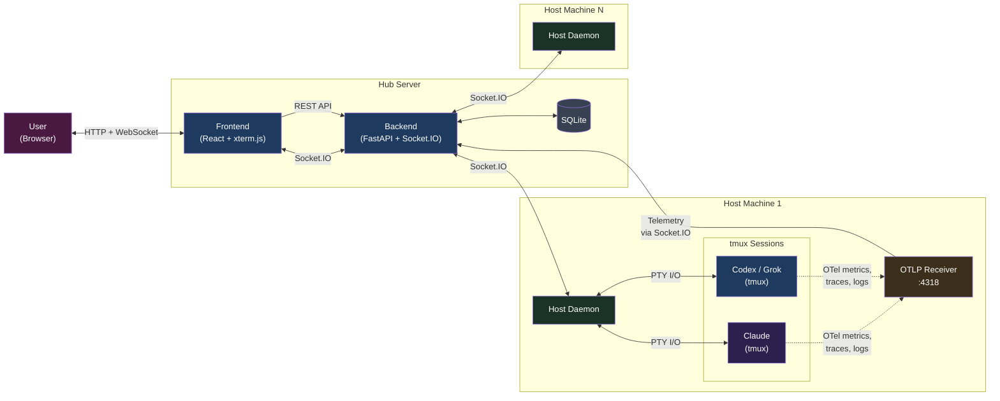
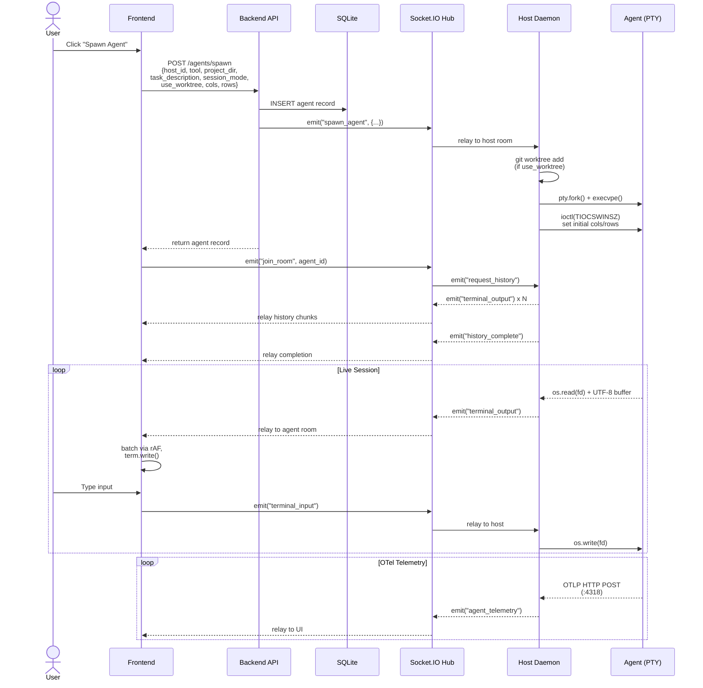
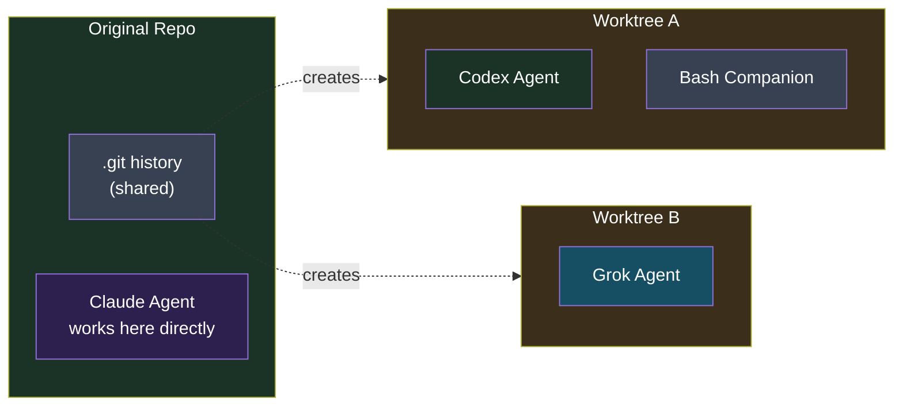

<p align="center">
  
</p>

<h1 align="center">Agent Dashboard Plus</h1>

<p align="center">
A multi-host orchestration platform for AI coding agents — spawn, monitor, and interact with Claude Code, Codex, Grok, and Bash sessions across multiple machines from a single web dashboard, on desktop or phone.
</p>

<p align="center">
  <a href="https://github.com/jorgeferrarice/agent-dashboard-plus/blob/main/LICENSE"></a>
  
  
  
</p>

> [!NOTE]
> **Agent Dashboard Plus is a modified derivative of
> [dustinblack/agent-dashboard](https://github.com/dustinblack/agent-dashboard)**
> by Dustin Black, licensed under Apache-2.0. All credit for the
> original design and code goes to its author. This repository
> contains modifications to the original files; see
> [What's new in this fork](#whats-new-in-this-fork). It is
> maintained for personal use and is not affiliated with the
> upstream project.

<p align="center">
  
</p>

## What's new in this fork

**Setup**
- **One-command install** — [`./setup.sh`](#quick-start) sets up
  the hub, registers the machine as a host and installs the daemon
  as a service on macOS and Linux (apt/dnf).
- **Agent harness** — the setup installs add-ons (Caveman, RTK,
  Graphify, Ponytail) and a set of skills into Claude Code, Codex
  and Grok, picked from a menu. See [Agent harness](#agent-harness).

**Sessions**
- **Tabs instead of popups** — Sessions open as tabs next to the
  Dashboard, sharing one Socket.IO connection per page. Only the
  active tab streams output.
- **Attention marks** — Tabs are marked when a session waits for a
  permission answer, finished working while unwatched, or ended;
  optional browser notifications.
- **Rename sessions** — From the tab's context menu or the settings
  cog; the name is shared across browsers.
- **Start in any folder** — Plain folders (not only git
  repositories) under the projects root can be picked, and new
  folders can be created from the spawn dialog, optionally with
  `git init`.
- **Searchable model list** — Profiles that declare a `models`
  section get a live, type-to-search model list in the spawn
  dialog, fetched from the host each time it opens.
- **Send files** — Drag files onto a terminal; they are saved on the
  host and their paths pasted at the prompt.
- **Resume on request** — An ended session is never respawned on its
  own; its tab offers **Resume**.

**Agent detection**
- **Several accounts per tool** — Every signed-in config directory
  (`~/.claude*`, `~/.codex*`, `~/.grok*`) is offered as its own tool,
  e.g. `~/.claude-work` becomes "claude-work".
- **Grok profile** — xAI's Grok CLI is supported out of the box.
- **Signed-out warning** — A tool installed but not signed in keeps
  its button with a warning mark.
- **Plan limits** — Each host card shows how much of the five-hour
  and weekly allowance each account has used.
- **Host settings** — Hide or rename each tool's button per host.

**Mobile**
- **Phone layout** — Compact header, larger touch targets, smaller
  terminal font on narrow screens.
- **Input bar** — Keys a phone keyboard lacks (Esc, Tab, arrows,
  Ctrl+C/D/R) and a text field with autocorrect and dictation.
- **Touch scroll and text selection** — Swipe scrolls the session's
  scrollback; a button shows the screen as selectable plain text.
- **Installable app** — Web app manifest and service worker, so the
  dashboard can be added to the home screen; tapping a notification
  opens the session.

**Reliability**
- **Restart button** — Each host card has **Restart**, which
  restarts that host's daemon after a confirmation dialog. It ends
  **every session on that host**. See
  [Restarting the Daemon](docs/host-daemon.md#restarting-the-daemon-from-the-dashboard).
- **Daemon fixes** — A background task can no longer die silently
  (which left every terminal blank); it logs and restarts. Stopping
  the daemon now cancels every task, so a restart no longer leaves
  the old process holding the OTLP port.

**Removed**
- The Pi, Antigravity (agy), OpenCode and OmniRoute profiles are not
  shipped. Included profiles: `bash`, `claude`, `codex`, `grok`
  (plus `agent/profiles/archive/gemini.yaml`). Add others from
  [`TEMPLATE.yaml.example`](agent/profiles/TEMPLATE.yaml.example).
- GitHub Actions CI and Dependabot. Run `./scripts/check.sh ci`
  locally instead.

## Quick start

```bash
git clone https://github.com/jorgeferrarice/agent-dashboard-plus.git
cd agent-dashboard-plus
./setup.sh            # interactive
./setup.sh --dry-run  # print every step without running it
./setup.sh --harness  # only the agent harness step (add-ons and skills)
./setup.sh --help
```

Supported: macOS, and Linux with `apt` or `dnf`. The script is
safe to re-run and keeps an existing `.env`. It asks before
installing anything. It:

1. **Finds a container runtime** — `docker` (OrbStack or Docker
   Desktop) and/or `podman`. If both are present it asks which to
   use. If none is, it offers to install one: OrbStack via Homebrew
   on macOS, Docker or Podman via apt/dnf on Linux.
2. **Installs missing tools** — `tmux`, `uv`, `git`, `node`/`npm`.
3. **Writes `.env`** — generated `SECRET_KEY` and `HOST_TOKEN`,
   the chosen `CONTAINER_RUNTIME`, `VITE_API_URL`, and a login mode:
   - **Google OAuth** — asks for `OIDC_CLIENT_ID`,
     `OIDC_CLIENT_SECRET`, `OIDC_DISCOVERY_URL` and `ALLOWED_EMAILS`
     (required). Register `<VITE_API_URL>/auth` as the redirect URI
     of your OAuth client.
   - **No login** — `BYPASS_AUTH=true`. Only for a dashboard reached
     from `localhost`; the script warns about it.
4. **Starts the hub** — builds and starts the backend and frontend
   containers with compose. The dashboard is at
   <http://localhost:8080> (`VITE_API_URL=http://localhost:8080`).
5. **Registers this machine as a host** automatically.
6. **Installs the host daemon as a service** that restarts on any
   exit, which the Restart button relies on:
   - macOS: LaunchAgent `com.agent-dashboard.daemon` (`KeepAlive`).
     Logs: `~/Library/Logs/agent-dashboard-daemon.log`.
   - Linux: systemd user unit `agent-dashboard-daemon.service`
     (`Restart=always`). Logs:
     `journalctl --user -u agent-dashboard-daemon`.
7. **Optional: Cloudflare Tunnel** for access from anywhere. Create
   a tunnel in the Cloudflare dashboard (Zero Trust > Networks >
   Tunnels), add a public hostname pointing to
   `http://localhost:8080`, then paste the tunnel token and the
   domain. The script installs `cloudflared` as a service and
   rebuilds the frontend for `https://<domain>`. It refuses to
   expose the dashboard when login is off.
8. **Optional: agent CLIs** — offers to install
   - Claude Code: `curl -fsSL https://claude.ai/install.sh | bash`
   - Codex: `npm install -g @openai/codex`
   - Grok: `curl -fsSL https://x.ai/cli/install.sh | bash`

   Sign in to each CLI you use; the daemon then offers it.
9. **Agent harness** — add-ons and skills for every agent you run.
   See [Agent harness](#agent-harness).

### Agent harness

`./setup.sh` (or `./setup.sh --harness` on its own) installs a
default harness into the AI agents on the machine. Two menus,
driven with the arrow keys, space to toggle and Enter to confirm
([gum](https://github.com/charmbracelet/gum), installed if missing):

1. **What to install.** Everything is selected at first; each line
   shows a one-line summary.
2. **Where to install it.** Every agent account found: `~/.claude`,
   extra Claude accounts such as `~/.claude-work`, `~/.codex`,
   `~/.grok` (and their extra accounts).

Re-running keeps things in sync: selected items are installed or
updated, and items **of this list** that are installed but no
longer selected are removed after you confirm. Anything else you
installed is never touched. Combinations an add-on does not support
are skipped and listed at the end.

Every selected account also gets a short instruction in its global
instructions file (`CLAUDE.md`, or `AGENTS.md` for Codex and Grok),
between `agent-dashboard-plus:skills` markers: check which skills
are available, use them when they fit, and suggest them when they
would help.

**Add-ons**

| Item | What it does | Agents |
|------|--------------|--------|
| [Caveman](https://github.com/JuliusBrussee/caveman) | Makes the agent answer tersely, keeping every technical fact and dropping filler, to save tokens. Set to `ultracave` (the most compressed mode) and active in every session (`~/.config/caveman/config.json`). | Claude Code (plugin), Codex, Grok (experimental, skills only) |
| [RTK](https://github.com/rtk-ai/rtk) | A hook that runs shell commands through `rtk`, which condenses their output (test runs, logs, git) before the agent reads it. `rtk gain` shows the savings. | Claude Code, Codex |
| [Graphify](https://github.com/Graphify-Labs/graphify) | Turns a codebase, its docs and schemas into a knowledge graph the agent can query instead of reading files one by one. Run `/graphify .` in a project to build it. | Claude Code, Codex |
| [Ponytail](https://github.com/DietrichGebert/ponytail) | "Lazy senior developer" rules: reuse before writing, standard library before dependencies, the shortest diff that works. Level `full`; `/ponytail lite\|full\|ultra` changes it. | Claude Code, Codex, Grok |

Codex asks you to trust new hooks once: run `/hooks` in Codex after
installing Caveman or Ponytail.

**Skills** (installed with [`npx skills`](https://github.com/vercel-labs/skills))

| Skill | Source | What it does |
|-------|--------|--------------|
| `grill-with-docs` | [mattpocock/skills](https://github.com/mattpocock/skills) | Interviews you relentlessly about a plan or design and writes the decisions down as it goes (ADRs, a glossary). |
| `tdd` | mattpocock/skills | Test-driven development: one failing test, the code to pass it, refactor, repeat. |
| `handoff` | mattpocock/skills | Compacts the conversation into a handoff document another agent can pick up. |
| `frontend-design` | [anthropics/skills](https://github.com/anthropics/skills) | Guides distinctive, intentional visual design for UI work instead of templated defaults. |
| `diagnosing-bugs` | mattpocock/skills | A disciplined loop for hard bugs and performance regressions: reproduce, hypothesize, measure, fix. |
| `prototype` | mattpocock/skills | Builds a throwaway prototype to answer a design question (state model, logic or UI) before committing to it. |
| `codebase-design` | mattpocock/skills | A shared vocabulary for designing deep modules, interfaces and seams. |
| `grilling` | mattpocock/skills | Grills you about a plan, decision or idea until it holds up. |
| `code-review` | mattpocock/skills | Reviews changes since a commit, branch or tag against coding standards and the spec, in parallel sub-agents. |
| `implement` | mattpocock/skills | Implements a piece of work from a spec or a set of tickets. |
| `wayfinder` | mattpocock/skills | Plans work too big for one session as a map of decision tickets in your issue tracker, resolved one at a time. |
| `design-taste-frontend` | [leonxlnx/taste-skill](https://github.com/leonxlnx/taste-skill) | Anti-slop art direction for landing pages and marketing sites, with a screenshot look-and-fix loop. |
| `ui-taste` | [uizze.sh](https://uizze.sh/) | Improves the agent's UI taste for web and iOS with Uizze's playbooks and real product references. |
| `ios-design` | uizze.sh | Designs and reviews iPhone UI in SwiftUI, UIKit or React Native against Apple's Human Interface Guidelines. |
| `wizard` | mattpocock/skills | Generates an interactive bash wizard for steps only a human can do (credentials, dashboards, migrations). |

Skills go to each agent's skills folder (`~/.claude/skills`,
`~/.agents/skills` for Codex, `~/.grok/skills`); extra Claude and
Grok accounts get links to the same copies.

### Security

- **Every session is a shell on the host.** Whoever can log in can
  run anything as your user.
- **`ALLOWED_EMAILS`** (comma-separated) restricts who can log in
  with OIDC. Without it, any Google account that completes the
  OAuth flow gets in.
- **Never expose the dashboard with `BYPASS_AUTH=true`** — not
  through a tunnel, a public IP or a shared network.
- **`.env` holds secrets** and is git-ignored. `.env.example`
  lists the keys with placeholders.

## Overview

Agent Dashboard is a **multi-host orchestration platform** for
AI coding agents. It remotely spawns, monitors, and provides
interactive terminal access to AI coding agent sessions
running across multiple development machines — all from a
single web interface. Supports Claude Code, Codex, Grok and
Bash out of the box, with new agents added via YAML profiles.

> [!TIP]
> **How it works:** The hub (backend + frontend) runs in
> containers. A host daemon runs on each development machine,
> natively as a service (what `./setup.sh` installs) or in a
> container. Open the web dashboard to spawn, monitor, and
> interact with AI agent sessions remotely — full terminal
> access, live telemetry, and cost tracking from your browser.

The platform consists of three layers: a **React frontend**
served by Nginx, a **FastAPI + Socket.IO backend hub** that
coordinates sessions, and **host daemons** on each development
machine. The daemons spawn agent processes inside tmux sessions
for terminal stability, relay I/O over Socket.IO, and collect
OpenTelemetry telemetry including token usage, model info, and
session cost.

> **Browser support:** Modern browsers (Chrome, Firefox, Edge,
> Safari 15+). The layout works on phones and tablets, with a
> touch input bar and touch scrolling.

## Features

### Core Architecture
- **Multi-host orchestration** — Run daemons on any number of
  development machines. Spawn and manage Claude, Codex, Grok and
  Bash sessions across all hosts from a single dashboard.
- **Extensible agent profiles** — Agent tools are defined by
  YAML/JSON [profile configs](docs/agent-profiles.md) rather
  than hardcoded logic. Each profile declares runtime behavior
  (commands, telemetry, permissions, accounts, models) and
  build-time provisioning (packages, config seeding, mounts, env
  vars). Add a new agent by copying the
  [profile template](agent/profiles/TEMPLATE.yaml.example) — no
  source code changes.
- **Remote PTY terminals** — Full `xterm-256color` terminal
  emulation via pseudo-terminals, not a log viewer or chat
  interface. Supports cursor movement, line-erase sequences,
  spinners, progress bars, and streaming LLM output.
- **Live telemetry (OpenTelemetry)** — Each host daemon runs a
  local OTLP receiver that captures model names, token usage
  (input/output/cache breakdown), and session cost directly from
  agent CLI tools — no screen-scraping or terminal interference.
- **Cost tracking** — Real session cost from Claude Code's OTLP
  metrics; estimated cost for other agents from built-in pricing
  tables. Displayed per-session on each agent card.
- **TUI frontend (experimental)** — Terminal-based dashboard
  alternative to the web UI, built with Python Textual. See
  [TUI documentation](docs/tui.md).

### Agent Management
- **Project selection** — Daemons scan `PROJECTS_ROOT` for git
  repositories and, up to `PROJECTS_FOLDER_DEPTH` levels, plain
  folders; pick one in the spawn dialog or create a new folder
  under `NEW_PROJECTS_DIR`.
- **Session resume** — The spawn modal includes a session mode
  toggle (Resume / New) for supported agents. Resume
  continues the most recent conversation in the selected project
  directory or worktree, preserving context across daemon
  restarts. New starts a fresh session. Resume is the default.
- **[Git worktree](https://git-scm.com/docs/git-worktree)
  isolation** — Optionally spawn agents in isolated git worktrees
  so multiple agents can work on the same repository without
  conflicts. Smart defaults enable isolation when another agent
  is already active on the project.
- **Companion sessions** — Open a Bash shell alongside any
  agent session in the same project directory. Companions
  inherit the parent's working context (worktree or original).
- **Host management** — Register, monitor, restart and delete
  hosts, with cascading cleanup of associated sessions.

### Terminal UX

<p align="center">
  
</p>

- **Session tabs** — Sessions open as tabs next to the Dashboard,
  in one browser window. Only the tab you are looking at has a
  live terminal and receives output; the others cost nothing, so
  many can stay open. Closing a tab leaves the session running.
  On a desktop, drag a tab to move it; the Dashboard tab stays
  first. Your open tabs and their order are saved to your login,
  so they are the same on every device you sign in from (another
  device picks up a change the next time it loads the page; the
  selected tab and the split stay per device). `Alt+1` goes to
  the Dashboard and `Alt+2`..`Alt+9` to the session tabs, in the
  order shown.
- **Host settings** — Each host has a **Settings** button next to
  **Delete**. It lists the AI tools found on that host: switch one
  off to hide its button there (the server then refuses to start
  it, from any browser; sessions already running carry on), or
  type a name to rename its button. Settings are per host. A tool
  that is installed but not signed in keeps its button, with a
  warning mark. A tool with saved settings that is no longer
  found stays in the list, muted, and comes back as it was.
- **Several accounts of one tool** — Extra configuration
  directories with a signed-in account (`~/.claude-work`,
  `~/.codex-team`, ...) are found by the daemon and each gets its
  own button. See [Accounts](docs/agent-profiles.md#accounts-config_dirs).
- **Plan limits** — Each host card shows, per AI account, how much
  of the five hour and weekly allowance is used, read by the
  daemon every five minutes. Click or tap an account for reset
  times. See [Plan limits](docs/host-daemon.md#plan-limits) for
  how it is read and how to turn it off.
- **Rename sessions** — Right-click a session tab, or open the
  settings cog while on one, and pick **Rename session**. Enter
  saves, Escape cancels. Leave the name blank to go back to the
  default tool and project label. The name is shared by every
  browser looking at the dashboard.
- **Attention marks** — A tab is marked when its session waits for
  a permission answer (red), finished working while you were not
  looking (blue), or ended (amber). The page title shows the total,
  the Dashboard tab counts sessions that have no tab, and the bell
  turns on browser notifications for when the page is in the
  background.
- **Send files to a session** — Drag files onto a terminal: they are
  saved on the session's host and their paths pasted at the prompt.
  Works with every tool. See
  [Sending Files to a Session](docs/host-daemon.md#sending-files-to-a-session).
- **Detached terminal windows** — The **Detach** button moves a
  session from its tab to a standalone browser window for
  side-by-side multitasking.
- **Resume on request** — A session that ended is never respawned
  on its own; its tab offers a **Resume** button.
- **Session history replay** — Switch away from a session and come
  back; recent output is automatically replayed.
- **Dynamic resizing** — Terminals scale to match the browser
  viewport in real-time, relaying geometry changes to the
  remote PTY.
- **Smooth rendering** — Output is coalesced at the PTY level
  and batched per animation frame on the frontend. Resize events
  are debounced and deferred during active streaming.
- **UTF-8 & multi-byte safety** — A byte buffer ensures
  multi-byte characters (box-drawing, emoji) are never split
  across reads.
- **Touch input** — On phones, swipes scroll the session and an
  input bar adds the keys a phone keyboard lacks, plus a text
  field with autocorrect and dictation.

### Telemetry & Monitoring
- **Token breakdown** — Per-session tracking of input, output,
  cache read, and cache creation tokens with compact display.
- **Context window bar** — Live visualization of current context
  window usage with dynamic scaling per model.
- **Bash session telemetry** — Current working directory, last
  command, and exit code displayed on bash cards via
  `PROMPT_COMMAND` sidecar injection.
- **Agent status** — Working, idle, and permission-waiting states
  derived from OTLP activity and terminal output patterns.
- **MCP server detection** — Detects configured MCP servers from
  `.mcp.json`, `~/.claude.json`, or `~/.gemini/settings.json`.
- **Version & upgrade notification** — The dashboard header
  displays the current version (auto-detected from git tags at
  build time) and checks the upstream project's GitHub releases,
  showing a subtle upgrade indicator when one is available (an
  upstream release is not merged into this fork automatically;
  set `GITHUB_REPO` on the backend to watch another repository).

## Manual setup

Prefer [`./setup.sh`](#quick-start). These steps do the same by
hand, for a hub and hosts on different machines or a containerized
daemon.

### Prerequisites

A container runtime with compose support on the hub server:

| Platform | Command |
|--------|---------|
| Fedora / RHEL 9+ | `sudo dnf install podman podman-compose` |
| Debian / Ubuntu | `sudo apt install podman podman-compose` or install [Docker Engine](https://docs.docker.com/engine/install/) |
| macOS | [OrbStack](https://orbstack.dev/), [Docker Desktop](https://www.docker.com/products/docker-desktop/), or `brew install podman podman-compose` |

> [!NOTE]
> **macOS (Podman):** Podman on macOS runs containers inside
> a Linux VM. Initialize and start it once with
> `podman machine init && podman machine start`; after reboots,
> `podman machine start`.

### 1. Configure and start the Hub

```bash
git clone https://github.com/jorgeferrarice/agent-dashboard-plus.git
cd agent-dashboard-plus
cp .env.example .env   # then fill in the values
podman-compose build && podman-compose up -d
```

The compose file starts two services:
- **backend** on port `8000` — FastAPI + Socket.IO hub
- **frontend** on port `8080` — React UI served by Nginx, which
  also proxies the API and Socket.IO, so the browser only needs
  port `8080`

The SQLite database is persisted in a named volume
(`dashboard_data`) that survives container restarts.

> [!NOTE]
> **Docker / OrbStack users:** Replace `podman-compose` with
> `docker compose` in all commands.

### 2. Network and login

Set `VITE_API_URL` in `.env` to the address the browser uses to
reach the frontend (`http://localhost:8080`, or
`https://your-domain` behind a tunnel or reverse proxy), then
rebuild: `podman-compose build --no-cache && podman-compose up -d`.

> [!IMPORTANT]
> **Authentication is enforced by default** with OIDC (Google
> OAuth or any OIDC provider): set `OIDC_CLIENT_ID`,
> `OIDC_CLIENT_SECRET`, `OIDC_DISCOVERY_URL`, `SECRET_KEY` and
> `ALLOWED_EMAILS` in `.env`, and register `<VITE_API_URL>/auth`
> as the redirect URI. For a dashboard reached only from
> `localhost`, `BYPASS_AUTH=true` turns login off — never expose it
> that way. See [Security](#security).

### 3. Register a Host

Register each development machine with the hub (a logged-in
session, or `BYPASS_AUTH=true`, is required):

```bash
curl -X POST http://localhost:8000/hosts \
  -H "Content-Type: application/json" \
  -d '{"name": "my-dev-workstation", "host_token": "<long random token>"}'
```

### 4. Run the Host Daemon

**Natively (recommended, what `./setup.sh` does):** put
`HOST_TOKEN` in `.env` and run
[`scripts/run-daemon-native.sh`](scripts/run-daemon-native.sh)
under a supervisor that restarts it on any exit (launchd
`KeepAlive`, systemd `Restart=always`). The daemon then sees the
agent CLIs and accounts installed on the host.

**In a container:**

```bash
cd agent/
# Generate Containerfile from template + agent profiles
# (only needed after adding or modifying profiles)
python3 generate_containerfile.py
podman build -t agent-dashboard-daemon -f Containerfile .

podman run -d --name host-daemon --network=host \
  --restart=always \
  -e DASHBOARD_URL="http://your-server-ip:8000" \
  -e HOST_TOKEN="<the same token>" \
  -e PROJECTS_ROOT="/git" \
  -v /path/to/your/git:/git \
  -v $HOME/.ssh:/root/.ssh:ro \
  -v $HOME/.gitconfig:/root/.gitconfig:ro \
  -v $HOME/.claude/:/root/.claude \
  -v $HOME/.claude.json:/root/.claude.json:ro \
  -v $HOME/.codex:/root/.codex \
  -v $HOME/.grok:/root/.grok \
  localhost/agent-dashboard-daemon:latest
```

Create any missing config directory first
(`mkdir -p ~/.claude ~/.codex ~/.grok`). `--restart=always` is
needed for the dashboard's **Restart** button to bring the daemon
back.

> See the [Host Daemon Reference](docs/host-daemon.md) for the
> full list of environment variables, volume mounts, and
> authentication configuration. To run containers as systemd
> services, see [Running as a System Service](docs/systemd-quadlets.md).

### 5. Use the Dashboard

1. Open `http://localhost:8080` (or your domain)
2. Your registered hosts appear on the dashboard
3. Click a tool button on a host card (**Claude**, **Codex**,
   **Grok**, **Bash**, one per detected account)
4. Pick a project or folder, then spawn
5. Click a running session to open it in a tab
6. Use **Restart** if a host's sessions stop showing output, and
   the trash icon to delete retired hosts

## Architecture



### Agent Spawn Flow

When a user clicks "Spawn" in the UI, the request passes through
three services before an agent process starts:



### Git Worktree Isolation

When multiple agents need to work on the same git repository,
they can conflict — editing the same files, switching branches,
or corrupting the index. Git
[worktrees](https://git-scm.com/docs/git-worktree) solve this
by creating lightweight copies of the working tree that share
the same `.git` history but have independent file state.

The spawn modal includes an **"Isolate in worktree"** toggle
that controls this behavior. The toggle defaults to **off** —
agents work directly in the original project directory, which
is the normal single-agent workflow. However, if the dashboard
detects that another agent is already active on the same project
and host, the toggle automatically switches on as a **smart
default** to prevent conflicts. You can always override the
toggle in either direction before spawning.

Companion sessions (e.g. a Bash shell opened from an agent
session) always inherit the parent's working directory —
whether that's the original repo or a worktree. No additional
worktree is created for companions.

When enabled, the daemon creates a new worktree with its own
branch under `.agent-worktrees/`. On the initial spawn, the
session mode is set to "New" since the fresh worktree has no
prior conversation history. However, if the agent is later
reconnected (e.g. after a daemon restart), it resumes in the
same worktree where the previous session's context is preserved.
The worktree and its branch are automatically cleaned up when
the agent is stopped.



In this example, three agents work on the same project without
conflicts: one Claude agent works directly in the original repo,
while a Codex agent (with a Bash companion) and a Grok agent
each have their own isolated worktree with a separate branch.

## Troubleshooting

| Problem | Cause | Fix |
|---------|-------|-----|
| Terminal popup shows nginx 404 | Fedora base image update added a conflicting default server block | Rebuild frontend container (fixed in v0.4.0) |
| `netavark: setns: Operation not permitted` when running podman inside daemon | Nested container networking blocked | Daemon Containerfile configures `slirp4netns` automatically |
| Agent card reappears after clicking Stop | Terminal popup auto-reconnects the session | Close the terminal window before stopping, or upgrade to v0.3.1+ |
| `1;2c` appears in agent input | Terminal DA response leaks into stdin | Upgrade to v0.3.1+ (filtered automatically) |
| Token counts grow unrealistically | OTLP cumulative counters were double-counted | Upgrade to v0.3.1+ |

## Similar Tools

There are a growing number of projects in the AI agent
orchestration space. To help you evaluate whether Agent
Dashboard fits your workflow, here are some alternatives we
are aware of along with an objective comparison of their
strengths and trade-offs:

- **Agent Dashboard** (This project)
  - A web-based platform that provides multi-host orchestration and remote pseudo-terminal (PTY) access to AI agent sessions with live OpenTelemetry metrics. Supports optional git worktree isolation for running multiple agents on the same repository, real-time cost tracking, and companion session chaining.
  - **Ideal for:** Remote, web-based interaction with isolated AI agent sessions across multiple host machines via full PTY emulation.
  - **Not ideal for:** Users who prefer to work exclusively within a local, native terminal multiplexer.
  - **Restrictions:** Ships profiles for Claude Code, Codex, Grok, and Bash sessions; other CLI agents need a profile. Does not orchestrate GUI-based agents, arbitrary scripts, or non-interactive processes.

- **[Agent Commander](https://github.com/cvsloane/agent-commander)**
  - A mission-control dashboard and tmux-first manager for AI agent sessions across multiple hosts. Built with Next.js, Fastify, and a Go-based agent daemon. Features approval queues for agent governance, scoped memory systems, and scheduling with runtime reuse.
  - **Ideal for:** Terminal-native users who want to orchestrate multi-host AI agent sessions with built-in approval workflows and agent governance.
  - **Not ideal for:** Users seeking a lightweight setup without an approval queue or those unfamiliar with terminal multiplexers.
  - **Restrictions:** Heavily integrated with `tmux` for session management and terminal control.

- **[Agent Orchestrator](https://github.com/ComposioHQ/agent-orchestrator)**
  - An open-source orchestration layer (by Composio) for fleets of parallel AI coding agents (Claude Code, Aider, Codex). It uses a dual-layer design with a **Planner** to decompose backlog issues (GitHub/Linear/Jira) and an **Executor** to handle technical interactions in isolated **git worktrees**.
  - **Ideal for:** Automating a full "Agent Ops" lifecycle, including autonomous CI healing (detecting and fixing breaking code), review handling (routing comments back to agents), and parallel PR management.
  - **Not ideal for:** One-off interactive chat sessions or developers who prefer a strictly local, dependency-free setup.
  - **Restrictions:** Its integration layer (tools, trackers, and notifications) is powered by the **Composio API**, typically requiring an API key and tying it to the Composio ecosystem. It is heavily optimized for CI-centric workflows.

- **[Botminter](https://botminter.github.io/botminter/)**
  - A "batteries-included" CLI tool that treats an AI coding team and its processes as a version-controlled Git repository. It functions as an orchestrator (using the **Ralph orchestrator**) to provision specialized agents following specific organizational "profiles."
  - **Ideal for:** Teams wanting to standardize AI workflows across an entire organization with version-controlled coding standards, documentation rules, and architectural patterns.
  - **Not ideal for:** Simple, one-off tasks or users who prefer a graphical dashboard over a CLI-first, configuration-as-code approach.
  - **Restrictions:** Currently in **Pre-Alpha** and heavily optimized for the **Claude Code** ecosystem, with deep integrations for GitHub repos and boards. Its profiles are currently primarily designed for Claude.

- **[Claude Squad](https://github.com/smtg-ai/claude-squad)**
  - A command-line multiplexer for running multiple AI coding assistants simultaneously, utilizing `git worktree` to isolate concurrent tasks into separate branches.
  - **Ideal for:** Multiplexing multiple AI coding assistants simultaneously in isolated local environments from the command line.
  - **Not ideal for:** Managing remote agent sessions across different physical machines or needing a web-based UI.
  - **Restrictions:** Relies on local `git worktree` isolation and is primarily focused on a specific set of supported CLI assistants (Claude, Gemini, Aider) rather than arbitrary commands.

- **[Zinc](https://github.com/ComeBertrand/zinc)**
  - A Rust-based agent management daemon that runs AI coding agents as persistent background processes. Zinc manages agents, not terminal panes — it works inside tmux, zellij, or a bare terminal, providing an interactive supervisor dashboard for switching between agents.
  - **Ideal for:** Running AI coding agents as persistent background daemons and seamlessly switching between them from the terminal.
  - **Not ideal for:** Web-based multi-machine orchestration or graphical monitoring of token/cost telemetry.
  - **Restrictions:** Local-only execution with no built-in mechanism for multi-host remote orchestration or visual telemetry dashboards.

## Development

### Prerequisites

- Python 3.9+
- Node.js 22+
- `pip` and `npm`

### Setup

```bash
# Install Python dev dependencies
pip install -r backend/requirements.txt \
            -r agent/requirements.txt \
            -r requirements-dev.txt

# Install frontend dependencies
cd frontend && npm install && cd ..

# Install the pre-commit hook
./scripts/install-hooks.sh
```

> [!IMPORTANT]
> **AI agent development:** If you are using an AI coding agent
> (Claude Code, Codex, etc.) to develop on this project,
> always install the pre-commit hook first. AI agents can
> introduce formatting, linting, and type errors that slip past
> review. The hook catches these automatically on every commit.

### Running Checks

```bash
./scripts/check.sh <category>
```

| Category | What it runs |
|----------|-------------|
| `format` | `black` (Python), `prettier` (frontend) |
| `lint` | `flake8` + `pylint` (Python), `eslint` (frontend) |
| `typecheck` | TypeScript type checking (`tsc`) |
| `build` | Frontend production build |
| `test` | Backend unit tests with coverage |
| `e2e` | End-to-end tests |
| `security` | `bandit` (Python), `npm audit` (frontend) |
| `secrets` | Secret detection (`gitleaks`) |
| `containers` | Build all container images |
| `precommit` | format + lint + typecheck + secrets (fast) |
| `ci` | format + lint + typecheck + build + test + security + secrets |
| `all` | ci + e2e + containers |

### Continuous integration

This fork has no GitHub Actions. Run `./scripts/check.sh ci`
before pushing; it covers formatting, linting, type checks, the
build, tests, security and secret detection.

Coverage reports are generated at `coverage/backend/index.html`.
